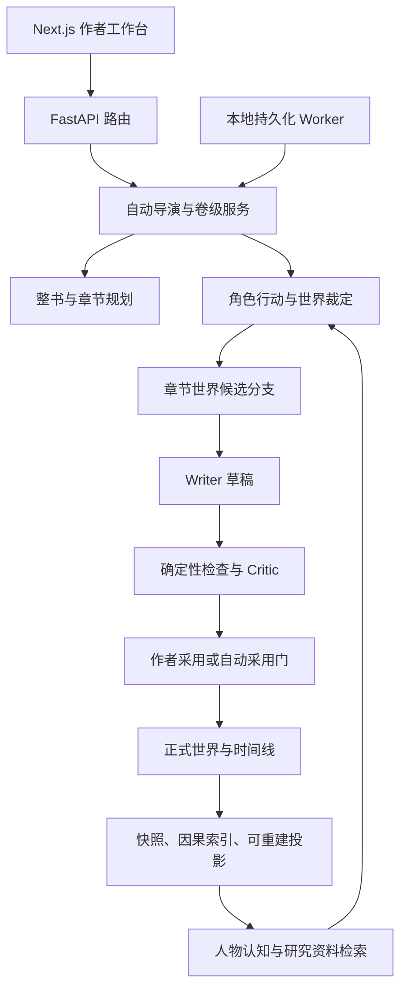

# 系统能力与工程诊断

## 阅读范围

本诊断依据当前仓库源代码、迁移、测试、产品说明和既有开源研究记录。当前相关应用与测试文件共 187 个，ORM 定义 89 张表。结论中的“已验证”只表示由代码检查或本轮指定测试支持，不代表生产环境容量、真实模型效果或文学质量已验证。

全文用“事实”标记代码或测试直接支持的内容，用“风险判断”标记依据这些事实推导的产品影响，用“待验证”标记缺少真实运行或用户研究证据的问题。P1/P2 是本项目建议的治理优先级，不是 CVSS 严重度。

项目工作树原有未跟踪 `AGENTS.md` 与 `.playwright-cli/`。本阶段未改动它们。没有连接或查询作者的小说数据库，没有读取密钥，没有调用真实模型。

## 架构轮廓

部署以单作者本地应用为目标。FastAPI 与 Next.js 位于同一代码仓库，API 依赖 SQLAlchemy，默认数据库是 SQLite；FastAPI 启动时创建一个本地后台 Worker。PostgreSQL、pgvector、ANN 索引和部分优化路径有独立测试，但依赖真实 PostgreSQL 的测试会在未设置 `DATABASE_URL` 时跳过。[main.py](../../../apps/api/app/main.py#L6) · [db.py](../../../apps/api/app/db.py#L6) · [PostgreSQL 测试标记](../../../apps/api/tests/test_retrieval_index_postgres.py#L26)

## 已具备的实际能力

### 作者与规划工作流

产品包括新书向导、整书规划、章节任务、人物与世界资料、卷合同、章节编辑、质量意见定位、版本历史、导出和恢复等工作台。整书规划持久化为 StoryPlan、卷、弧与章节任务。长篇推进服务要求获批计划和锁定的当前任务，返回状态与进度摘要。[api.py](../../../apps/api/app/api.py#L590) · [planning.py](../../../apps/api/app/planning.py#L249) · [long_form.py](../../../apps/api/app/long_form.py#L26)

### 自动导演与正文生产

全自动和作者卷级是两条编排路径。全自动导演生成方向与规划，按阶段保存 AutoDirectorStep，然后驱动角色/世界模拟、Writer、Critic、修复和采用。作者卷级路径按窗口推进，封卷时创建连续性快照，跨卷沿用运行与预算。当前没有统一单一执行内核，很多 Writer、审核和状态部件复用，但路径各自维护上下文、预算和恢复入口。[auto_director.py](../../../apps/api/app/auto_director.py#L367) · [author_guided_volume.py](../../../apps/api/app/author_guided_volume.py#L1620)

### 角色 Agent、正式世界与时间线

项目同时包含角色决策、场景表演、世界裁定和自动导演运行。人物可维护结构化知识、记忆、错误信念及因果使用记录。场景正式提交会写入状态差异、时间线事件、因果关系和场景检查点。历史改写采用影响分析、认知失效和显式回放，待回放完成后才能继续推进。自动章节在采用前使用 ChapterWorldBranch 保存候选状态。[character_mind.py](../../../apps/api/app/character_mind.py#L212) · [scene_commit.py](../../../apps/api/app/scene_commit.py#L1) · [chapter_world_branch.py](../../../apps/api/app/chapter_world_branch.py#L45) · [retcon_apply.py](../../../apps/api/app/retcon_apply.py#L26) · [replay.py](../../../apps/api/app/replay.py#L319)

### Writer 与 Critic 的工程职责

Writer 在严格 JSON 模式下输出章节题目、正文、场景覆盖、来源引用、POV 角色和任务覆盖。确定性校验会检查场景覆盖、引用 ID、POV 角色 ID、字数边界和规划覆盖。Writer 本身只创建候选草稿，采用发生在独立质量门之后。[writer.py](../../../apps/api/app/writer.py#L51) · [writer.py](../../../apps/api/app/writer.py#L480) · [writer.py](../../../apps/api/app/writer.py#L569)

Critic 输出固定分数、findings、决策和必需剧情事件的逐项审核。事件审核必须引用正文中精确匹配的 excerpt 和偏移；采用时会重建并比较证据指纹。确定性规则另行检查场景节拍、正式来源、知识使用、时间线和部分风格约束。[quality.py](../../../apps/api/app/quality.py#L263) · [quality.py](../../../apps/api/app/quality.py#L658) · [auto_director.py](../../../apps/api/app/auto_director.py#L129) · [auto_director.py](../../../apps/api/app/auto_director.py#L1147)

这些机制能证明记录格式、引用来源和约束门是否工作。它们不能单独证明人物可信、因果有张力、语言有感染力或读者愿意追读。

### RAG、长期记忆与历史

研究资料链包含文档修订、分块、词法索引、可选向量索引和混合 RRF 排序，命中返回文档修订、chunk 指纹和来源类别。角色认知链以结构化知识和记忆为正式来源，先按明确 cue、状态、使用次数、时间等信号做确定性排序，再可选混合向量排序。投影索引设计为可重建缓存，不能取代正式事实。[research.py](../../../apps/api/app/research.py#L384) · [research.py](../../../apps/api/app/research.py#L565) · [character_mind.py](../../../apps/api/app/character_mind.py#L269) · [retrieval_index.py](../../../apps/api/app/retrieval_index.py#L142)

数据库用不可变或版本化记录表达章节草稿、审核、场景、快照、时间线、因果关系和恢复队列。快照除了完整形式，还提供紧凑 delta/reference 存储。它能为溯源、恢复和改写提供支撑，同时增加迁移、投影一致性与人工诊断成本。[models.py](../../../apps/api/app/models.py#L473) · [models.py](../../../apps/api/app/models.py#L1152) · [models.py](../../../apps/api/app/models.py#L1300) · [snapshot_storage.py](../../../apps/api/app/snapshot_storage.py#L1)

## 已确认的工程缺口

### P1 全自动导演覆盖作者指定的叙事视角

**事实** 作者设定和章节任务均携带 `pov`/`pov_mode`，Writer 可接收多种 POV，但全自动导演写章时直接传入 `THIRD_PERSON_LIMITED`，没有使用 framing、卷合同或当前章节任务中的 POV。Writer 随后按该值过滤可见事实。[auto_director.py](../../../apps/api/app/auto_director.py#L647) · [auto_director.py](../../../apps/api/app/auto_director.py#L928) · [writer.py](../../../apps/api/app/writer.py#L208)

**风险判断** 当作者明确指定第一人称、客观视角或章节视角时，系统可能以错误视角生成，并按错误视角过滤信息。

**待验证** 真实作品受此影响的比例，以及章节级 POV 覆盖应优先于书级 POV 的规则，尚未端到端测试。

### P1 未返回 token 用量时，Token 预算按零累加

**事实** `ModelResult.usage` 默认 `{}`。全自动 `_model_usage` 和 `_check_budget` 把缺失用量读作 `0`。作者恢复路径会对超时或失联请求预留用量，但成功返回缺少 usage 时没有相同的不确定性标记。[provider.py](../../../apps/api/app/ai/provider.py#L8) · [auto_director.py](../../../apps/api/app/auto_director.py#L184) · [auto_director.py](../../../apps/api/app/auto_director.py#L233) · [author_recovery.py](../../../apps/api/app/author_recovery.py#L82)

**风险判断** 当前预算能约束已报告用量，不能保证缺少 usage 的 provider 遵守实际 token 或账单上限。

**待验证** 实际模型供应商漏报用量的比例、各类调用的 token 上界和账单误差尚未测量。

### P1 首次配置模型时，默认页面可能发出无密钥测试并得到 HTTP 500

**事实** 模型设置页有非空默认 Base URL，首次载入会自动调用项目模型测试，且不会发送尚未输入的 key。API 捕获 `ModelProviderError`，但缺 key 分支抛出普通 `ValueError`。隔离内存数据库探针观察到 HTTP 500，没有发起外部请求。[model-config/page.tsx](../../../apps/web/app/projects/%5Bid%5D/model-config/page.tsx#L40) · [api.py](../../../apps/api/app/api.py#L1512) · [api.py](../../../apps/api/app/api.py#L1520)

**风险判断** 首次配置体验可能先显示服务端错误，错误状态也会掩盖“需要输入 key”的真实原因。

**待验证** 用户已有环境级 `AI_API_KEY` 时会进入其他分支；不同启动器和配置组合还需测试。

### P1 保存项目密钥依赖未被启动文档说明的主密钥

**事实** 项目密钥使用 Fernet 存储，加解密依赖 `AI_CREDENTIAL_MASTER_KEY`。未配置主密钥时保存接口返回 `MODEL_CREDENTIAL_VAULT_NOT_CONFIGURED`。当前 README 与启动脚本没有说明如何生成或持久保存主密钥。[embeddings.py](../../../apps/api/app/embeddings.py#L120) · [api.py](../../../apps/api/app/api.py#L1420) · [api.py](../../../apps/api/app/api.py#L1453) · [test_memory_embeddings.py](../../../apps/api/tests/test_memory_embeddings.py#L176)

**风险判断** 用户照默认启动流程进入设置时，保存 key 可能失败；主密钥丢失会使已有加密凭据不能解密。

**待验证** 当前用户部署中的主密钥生成、环境变量持久化和备份状态未知，本阶段没有读取本机配置。

### P1 Critic 的 PASS 不是经校准的文学质量保证

**事实** 质量门对 Critic schema、引用和 excerpt 做格式与来源校验，分数阈值默认 70，并与确定性 findings 一起决定 PASS。分数和决策由 Critic provider 返回；自动采用把 PASS 当作必要条件之一。[quality.py](../../../apps/api/app/quality.py#L611) · [quality.py](../../../apps/api/app/quality.py#L658) · [quality.py](../../../apps/api/app/quality.py#L798) · [auto_director.py](../../../apps/api/app/auto_director.py#L129)

**风险判断** 这些校验能证明结构、范围和部分证据一致，不能证明分数与中文读者、编辑或作者判断相关。PASS 是自动流程门，不等价于文学质量认证。

**待验证** 当前没有 Critic-human 盲评相关性、跨模型稳定性或阈值校准结果。Fake provider 的高分测试只验证流程。[test_quality_gate.py](../../../apps/api/tests/test_quality_gate.py#L361)

### P1 当前“黄金小说”测试不能代表长篇创作能力

**事实** 黄金样本是规则回归用的合成元数据，不是 30 章正文。章节必需事件与 `delivered_events` 在同一循环构造，风格输入只有五个短段。测试用预置字段检查引用、知识状态、时间顺序、事件标签和规则检测。仓库说明称其为 regression contract。[golden_novel_fixture.py](../../../apps/api/tests/golden_novel_fixture.py#L5) · [test_golden_novel_baseline.py](../../../apps/api/tests/test_golden_novel_baseline.py#L14) · [GOLDEN_NOVEL_BASELINE.md](../../../apps/api/tests/GOLDEN_NOVEL_BASELINE.md#L1)

**风险判断** 若把该测试通过率展示成“已具备长篇写作能力”，会超出测试实际覆盖范围。

**待验证** 系统对原创中文多章文本的跨章因果、人物成长、情感、悬念、节奏、文风和读者留存尚无实测。

### P2 Writer 协议与实际校验并非完全一致

**事实** Writer prompt 说明 `prose` 非空，Pydantic 类型只有 `str`。默认字数下限为空，本轮隔离解析探针确认空字符串通过 schema。`task_coverage` 与 `task_forbidden_hits` 默认空数组，规划校验器消费 Writer 自报字段。Critic 必需事件有正文 excerpt 审核，禁用事件没有相同的语义审核。Grounding validator 还包含 `events/entities/locations/knowledge/memories/outcomes` 分支，但 strict schema 没有这些顶层字段。[writer.py](../../../apps/api/app/writer.py#L51) · [writer.py](../../../apps/api/app/writer.py#L480) · [writer.py](../../../apps/api/app/writer.py#L765) · [planning.py](../../../apps/api/app/planning.py#L210) · [quality.py](../../../apps/api/app/quality.py#L550)

**风险判断** 输出协议与验证器有可观察到的漂移。空正文和 Writer 自报的 forbidden-hit 清单不是可靠的语义质量证据。

**待验证** 真实 provider 输出空正文、漏报 forbidden event 或依赖未使用输出字段的比例未知。本阶段没有读取运行日志或小说正文。

## 高价值资产

- 采用门前有版本化草稿与质量评估；来源指纹变化会使草稿或 assessment 失效。
- 自动章节世界状态有运行与章节归属的候选 branch。通过后在采用链中发布正式状态，失败时可恢复。
- Critic 必需事件审核逐项绑定精确原文摘录、Unicode code-point 偏移、稿件指纹和规划引用。封卷使用已采用章及连续性快照证据。
- 后台运行持久化 run、step、租约、重试时间和检查点；状态投影可以从数据库恢复。
- 角色认知限制、来源权限、因果账本、快照与回放基础设施可形成严谨的事实型长篇引擎。
- SQLite 本地可启动与 PostgreSQL 可扩展两条路径都有目标清晰的测试边界。

这些是可保留的底层资产。它们的存在不等于长篇文学结果已验证。

## 过度工程化风险判断

### 可确认的成本

当前同时维护全自动导演、作者卷级导演、通用场景/表演 runtime、Writer/Quality 独立生命周期、章节世界分支、formal world snapshot、scene checkpoint、timeline/causal ledger、retrieval projections 与 retcon replay。这些抽象各有语义职责，但跨越 89 张表和多个审计/投影层。每增加一个可变路径，均需要验证状态主权、失效、备份迁移和恢复一致性。

### 尚未证明的风险

“过度工程化”不能仅凭表数量下定论。当前未见对真实作者任务时间、运行成本、索引维护成本或两个导演路径的复用率做过实测。后续应该用调用链、功能使用率、迁移失败率、恢复缺陷和端到端写作实验判断哪些投影有收益、哪些是重复事实，而不是先做大规模重构。

建议暂缓增加新的平台/Agent/索引层。先固定输出契约、成本不确定性、视角继承和文学评测基线，再按真实收益收敛架构。
